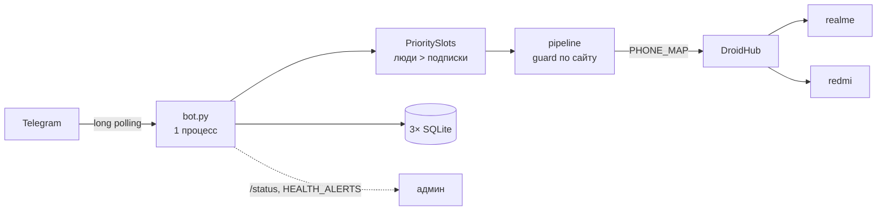
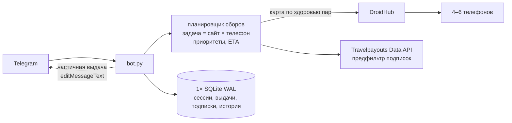
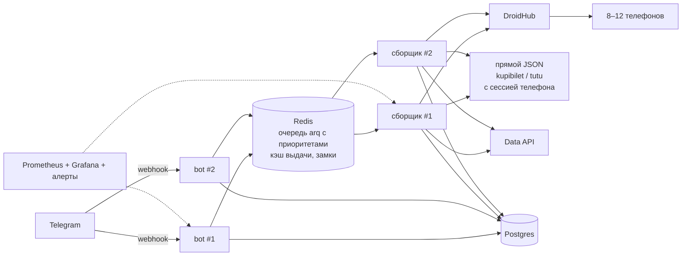

# 05. Roadmap масштабирования: 10 → 50 → 100 одновременных

Ступень — это число людей, которые **одновременно** нажали поиск, плюс та же аудитория в течение дня с подписками (сценарии A и B из `03_capacity.md`). Цифры ожидания взяты из симуляции на моках с профилем телефонов из замеров (профиль v2). Цены — порядок величины: проверить перед закупкой.

## 0. Отправная точка

- 1 процесс, long polling, 2 телефона (realme, redmi).
- Глобально не больше 2 поисков одновременно; каждый сайт не чаще раза в 30 с.
- Потолок 50–90 поисков/ч. Добавление телефонов после 4 почти ничего не даёт (`03_capacity.md` §4).
- 50 человек одновременно: последний ждёт 33–55 мин.

Главное правило дальше: **сначала снять программные ограничители, потом покупать телефоны.** Обратный порядок не работает: 16 телефонов при текущем коде загружены в среднем на 13%.

## 1. Ступень 10: включить готовое и закрыть дыры (1–2 недели)

| # | Работа | Оценка | Где |
|---|---|---|---|
| 1 | Влить ветки фазы 6 без включения флагов: telegram, dialog, docs, deploy, health | S | `06_changes.md` |
| 2 | Включить `PHONE_MAP`, `RETRY_OTHER_PHONE=1`, `SEARCH_PRIORITY=1`, `QUEUE_NOTICE=1`, `HEALTH_ALERTS=1`, неделю смотреть `/status` | S | `.env` |
| 3 | yandex `wait_for '"cont":null'`; `phone_wait_seconds` 15–20 с для быстрых сайтов | S | `sites.yaml` |
| 4 | Не кэшировать partial; парсер в `asyncio.to_thread` | S | `guard.py:145`, `pipeline.py:164` |
| 5 | Бюджет поисков на бота в час и защита открытого режима (`TG_OPEN`): лимит новых людей в сутки | S | `bot.py` |
| 6 | Деплой: compose или systemd, бэкап `state/` раз в сутки | S | ветка `scale-audit-deploy` |

Железо: 2 телефона (есть). Сервер: текущий Mac или VPS 2 vCPU / 2–4 ГБ (~700–1 500 ₽/мес).

Критерии готовности:
- 10 одновременных поисков: p95 ожидания ≤ 10 мин при 2 телефонах;
- доля успешных сборов по каждому сайту ≥ 85% за неделю (`/status`);
- 0 случаев «застрял в поиске», 0 потерянных уведомлений из-за 400/429;
- подписки опрашиваются не реже 1,5 обещанного интервала (`sched_intervals` в симуляции, `/status` в проде).

## 2. Ступень 50: планирование по телефонам, частичная выдача, дешёвый предфильтр (3–5 недель)

| # | Работа | Оценка | ADR |
|---|---|---|---|
| 1 | Единица планирования — сбор сайта на телефоне: замок на пару «сайт × телефон», `min_interval` на сайт по замерам антибота, глобальный семафор ≈ числу телефонов | M | 001 |
| 2 | Частичная выдача: быстрые сайты сразу, остальные дописываются редактированием | M | 001 |
| 3 | Одна SQLite в WAL, миграции, сессии и снимки выдачи в БД с TTL, ретеншн истории | M | 002 |
| 4 | Предфильтр подписок через Data API (`prices_for_dates`) + страховочный полный опрос раз в T часов | M | 003 |
| 5 | Адаптивная карта «сайт × телефон» по скользящей доле успеха, пробные запросы | M | 004 |
| 6 | Парсеры: `ParseStats`, единая политика пропуска, негативные снимки в тестах, `ParserSpec` вместо `sys.modules` | M | — |
| 7 | +2–4 телефона, держатель с охлаждением, USB-хаб с питанием, отдельные SIM | — | — |

Железо и деньги (оценка):
- 4–6 телефонов класса realme C21Y / Redmi Note 11: б/у ~7–12 тыс. ₽ за штуку разово. Амортизация на год ≈ 0,6–1 тыс. ₽/мес на телефон.
- SIM с мобильным интернетом ~300–600 ₽/мес на телефон. Разные IP снижают риск бана по IP.
- USB-хаб с питанием и охлаждение ~3–5 тыс. ₽ разово.
- VPS тот же.
- **Итого ≈ 4–8 тыс. ₽/мес** плюс время на обслуживание: перезагрузки, обновления Chrome, перегрев.

Критерии готовности:
- 50 одновременных: p95 ожидания ≤ 20 мин, первый ответ с частью сайтов ≤ 3 мин;
- день с 50 людьми и подписками (сценарий B): p95 ≤ 5 мин, подписки не реже 1,5 обещанного интервала;
- доля успешных сборов ≥ 90% по сайту.

## 3. Ступень 100: воркеры отдельно от бота, общее хранилище (1,5–3 месяца)

| # | Работа | Оценка | ADR |
|---|---|---|---|
| 1 | Очередь вне процесса (Redis + arq), сборщики отдельными процессами | L | 001 |
| 2 | Postgres вместо SQLite; Redis для кэша и замков | M–L | 002 |
| 3 | Webhook, бот без состояния, 2 экземпляра за балансировщиком | M | 002 |
| 4 | Прямые JSON-вызовы для 1–3 сайтов, если пройдут антибот (эксперимент с согласия владельца) | M–L | 003 |
| 5 | Метрики и алерты: очередь, ожидание, доля успеха по паре «сайт × телефон», температура и батарея телефонов | M | — |
| 6 | Юридическая проверка условий сайтов для открытого бота | — | — |

Железо и деньги (оценка):
- 8–12 телефонов с SIM ≈ 10–20 тыс. ₽/мес.
- 2 VPS или 1 мощнее (4 vCPU / 8 ГБ) ≈ 2–4 тыс. ₽/мес.
- Managed Postgres и Redis ≈ 2–5 тыс. ₽/мес (или на том же VPS бесплатно, но с бэкапами на вас).
- Мобильные прокси, если появятся прямые JSON-вызовы или эмуляторы: ~2–5 тыс. ₽/мес за порт.
- **Итого ≈ 15–35 тыс. ₽/мес.**

Критерии готовности:
- 100 одновременных: p95 ожидания ≤ 20 мин, первый частичный ответ ≤ 3 мин;
- сценарий B на 100 людях: p95 ≤ 5 мин, подписки не реже 1,5 интервала;
- рестарт любого процесса без потери поисков и сессий;
- одна точка отказа (DroidHub) — с алертом и деградацией на Data API.

## 4. Варианты сбора данных

| # | Вариант | Стоимость | Плотность | Антибот | Обслуживание | Когда брать |
|---|---|---|---|---|---|---|
| 1 | Больше физических телефонов | Линейная: ~1,5 тыс. ₽/мес на телефон с SIM | 1 запрос на телефон за раз, ~6–40 с на сайт | Лучший: настоящий Chrome на телефоне, мобильный IP | Перегрев, батареи, обновления, обрывы USB | Ступени 10–50; на 100 — вместе с 3–6 |
| 2 | Android в контейнерах (redroid) или эмуляторы | Сервер с KVM и binder: ~5–10 тыс. ₽/мес на 6–10 инстансов | Высокая | Хуже: отпечаток эмулятора, IP дата-центра → нужны мобильные прокси | Ядро с модулями, образы, прокси | Не раньше ступени 100 и только после проверки на 1–2 сайтах |
| 3 | Desktop-Playwright со stealth и прокси | Дёшево по железу, прокси ~2–5 тыс. ₽/мес | Высокая | ozon отдаёт заглушку уже сейчас; остальные — не проверено | Обновления stealth-плагинов | Для сайтов, которые это пропускают (замерить по одному) |
| 4 | Прямые JSON-эндпоинты с куками телефона | Почти бесплатно | Очень высокая: HTTP-запрос вместо открытия страницы | Неизвестно; риск бана сессии и IP | Подписи запросов, ротация кук | Самый большой выигрыш; эксперимент на ступени 50 |
| 5 | Travelpayouts Data API | Бесплатно (нужен `TP_TOKEN`) | Не ограничена телефонами | Нет | Нет | Предфильтр подписок уже на ступени 50. **Не живая цена**: кэш поисков пользователей Aviasales, окно 48 ч, хранение 7 дней |
| 5б | Aviasales Search API (живой) | — | — | — | — | Недоступен: Travelpayouts открывает только при подтверждённых 50 000 MAU. Дальний этап |
| 6 | Гибрид: подписки через 5, телефон — когда цена могла измениться | Как 1 + 5 | Снимает с телефонов основную долю фоновых поисков | Как 1 | Логика доверия кэшу | Рекомендуется со ступени 50 (ADR-003) |

## 5. Ключевые архитектурные решения

1. **Очередь задач с приоритетами** — ADR-001. Сейчас in-process `PrioritySlots`; на ступени 50 — задачи «сайт × телефон»; на 100 — Redis + arq (проще Celery для async-кода, Postgres-очередь — запасной вариант).
2. **Сборщики отдельно от бота** — ступень 100: бот не держит телефоны, падение сборщика не роняет диалоги.
3. **Единое хранилище** — ADR-002: одна SQLite WAL на ступени 50, Postgres на 100.
4. **Общий кэш выдачи** по маршруту, дате и сайту с TTL по источнику и схлопыванием одинаковых запросов между людьми. Уже есть в памяти (guard): вынести в Redis на ступени 100. Hit-rate в симуляции 13–28% сборов — популярные даты бесплатны.
5. **Webhook** — только на ступени 100, вместе с несколькими экземплярами; до этого long polling достаточен.
6. **Лимиты на человека и на бота**: 1 поиск за раз (есть), N в сутки (есть, 40), бюджет на бота в час (нет — добавить на ступени 10), лимит новых людей в открытом режиме.
7. **UX ожидания**: «вы N-й в очереди, примерно M минут» (готово, флаг), частичная выдача (ступень 50), предложение подписки вместо ожидания при длинной очереди.

## 6. Риски

| Риск | Вероятность | Влияние | Что делать |
|---|---|---|---|
| Условия сайтов (ToS) запрещают автоматический сбор; открытый бот на 100 человек — уже не «личный мониторинг» | Высокая | Блокировка, претензии | Юридическая оценка до открытия; приоритет официальных источников (Travelpayouts); не хранить и не перепродавать выдачу |
| Антибот: капчи, заглушки, бан по IP или сессии | Средняя, растёт с частотой | Сайт выпадает из выдачи | `min_interval` по замерам на сайт, разные IP у телефонов, health-алерты (готово), деградация на остальные сайты |
| 2 телефона и один DroidHub — единая точка отказа | Высокая | Бот без живых цен | Data API как запасной ответ «примерно, кэш»; алерт; запасной телефон |
| Телефоны общие с другими клиентами DroidHub | Средняя | Непредсказуемая очередь, 429 | Учитывать 429 как «занято, подожди», а не как сбой; договориться о квоте |
| Перегрев и износ телефонов при сотнях запросов в час | Не проверено (бюджет аудита 40/ч) | Отказы телефонов | Мониторинг температуры и батареи (`device_status`), гасить экран, охлаждение |
| Тихая поломка парсера после изменения сайта | Высокая на горизонте месяцев | Неверные или пустые цены | `/status`, `HEALTH_ALERTS`, `ParseStats`, негативные тесты |
| Утечки: инфраструктура в публичном репо, снимки страниц в `debug/` | Есть сейчас | Компрометация сервера, ПДн | Ветка `scale-audit-docs`, ротация `debug/`, решение владельца о переписывании истории |
