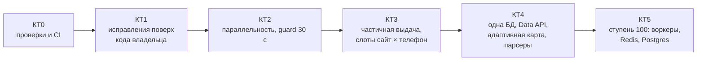

# 07. План развития: контрольные точки, проверяемые тестами

План ведёт avia-bot от текущего кода к 100 одновременным людям через 6 контрольных точек (КТ0–КТ5). Сроков в плане нет: следующая точка начинается, когда пройдена предыдущая. Точка считается пройденной, когда выполнены два условия:
- зелёные `pytest` и проверка мощности `loadtest/gate.py` с порогами из этого документа;
- для точек, которые меняют прод, — неделя живых метрик в `/admin`.

Пороги взяты из замеров аудита (профиль телефонов v2, seed 7, `03_capacity.md` и `06_changes.md`) с запасом ~15% на шум симулятора (±10% между одинаковым кодом).

**Обновление 2026-11-05 (решения владельца, `docs/review/upstream.md`).**
- Владелец влил в `upstream/main` свой код `2b4ff8b` (`08_upstream.md`). С КТ1 база — он, а не `scale-audit-all`.
- Эталоны v2 остаются историей. Пороги КТ1 и дальше считаются от эталонов `2b4ff8b` (`*_v3base.json`, КТ0, работа 6).
- Шум сильнее, чем считалось. На одном коде и одном seed последний в A 50/4 ждал 40,9 мин под нагрузкой машины и 45,7 мин на тихой. Поэтому эталоны снимаются только на тихой машине, а разброс проверяется на 3 seed (7, 11, 13).

## Сводка

| КТ | Что получаем | Автоматическая проверка | Главный порог | Кто подтверждает |
|---|---|---|---|---|
| 0 | Проверки мощности исполняются, CI на каждый PR | `pytest`, `gate --profile quick` в CI | Базовая линия воспроизводится ±15% | Чат |
| 1 | Исправления поверх `2b4ff8b`: P0, Telegram, оповещения, «вы N-й», телефоны 3+ | `gate --profile kt1` | 0 застреваний в поиске; A 50/4: последний ≤ 28 мин | Владелец по `/admin` за 7 дней |
| 2 | Параллельность при прежнем интервале 30 с | `gate --profile parallel` | A, 50 чел./4 тел.: последний ≤ 20 мин | Владелец по `/admin` за 7 дней |
| 3 | Первый ответ за минуты, слоты «сайт × телефон» | `gate --profile stage50a` | A, 50/4: первая частичная выдача p95 ≤ 3 мин | Чат + живой прогон |
| 4 | Состояние переживает рестарт, подписки через Data API, карта по здоровью | `gate --profile stage50` | B, 50/4: люди p95 ≤ 5 мин, подписки p95 ≤ 1,5× | Владелец по `/admin` |
| 5 | Несколько процессов, 8–12 телефонов | `gate --profile stage100` + chaos-тесты в compose | A, 100/8: p95 ≤ 20 мин; рестарт без потерь | Владелец |

## Общие правила для каждой КТ

- **Одна работа — одна ветка** от актуальной базы. КТ0 — от `kt0-gates` (`6026c12`). С КТ1 — от `upstream/main` `2b4ff8b`, дальше — от `main` после влития КТ1. Имя ветки: `kt<N>-<тема>`.
- **Сначала тест, потом код.** Каждая новая функция приходит с тестом, который без неё падает. Новые модули покрыты на 80% и больше.
- **Поведение по умолчанию не меняется**, новое включается флагом в `.env`. Исключение — чистые багфиксы.
- **Отчёт по точке** — файл `docs/audit/kt<N>.md`:
  - команды проверки и их вывод (таблица `gate`);
  - что не проверено;
  - какие флаги включать.
- **Регрессия запрещена.** Профиль `quick` гоняется на каждый PR. Если что-то стало хуже порога предыдущей КТ, PR не вливается. Пороги — относительно эталонов своей базы: `gates.yaml` хранит коммит, на котором снят эталон.
- **Живые сайты нагрузкой не проверяются.** Мощность меряется только в симуляторе; телефоны — не больше 40 запросов в час.

## КТ0. Проверки и CI (поведение бота не меняется)

Нужна, чтобы каждая следующая точка проверялась одной командой, а не вручную по таблицам.

Работы:
1. `loadtest/gate.py`: запускает профиль из `loadtest/gates.yaml`, сравнивает JSON прогонов с порогами и завершается с кодом 1, если порог не пройден. Вывод — таблица «метрика / порог / факт / ok».
2. Профили:

   | Профиль | Что гоняет | Где запускать |
   |---|---|---|
   | `quick` | A 10 чел./2 тел., A 50/4 | CI, на каждый PR |
   | `full` | A 100/8, B 100/2, B 100/4 | вручную, перед приёмкой точки |

3. В `run.py` добавить метрику `first_partial`: время до первого сообщения с частью сайтов. Пока частичной выдачи нет, она равна полной.
4. Исправить артефакт симулятора (DECISIONS #24): виртуальные сутки начинаются в местную полночь, и лимит в 40 поисков считается правильно. Пересчитать базовую линию.
   - Влить `docs/audit/08_loadtest.patch` (sha1 `145c1b5`): в нём проверки под новые тексты диалога владельца. Без патча на `2b4ff8b` все виртуальные люди получают error. Бота патч не меняет.
5. GitHub Actions: Python 3.12, `pytest -q` без сети, `gate --profile quick`. Запуск на push и PR.
   - Снимки для мока — 11 файлов в `loadtest/samples/*.json.gz`.
   - Метка рекламного клика onetwotrip (`srcMarkers`, `srcmarker`, `source`) вычищается до первого коммита: форк публичный.
   - Мок читает явный список снимков, а без снимка падает с ошибкой.
6. Перенести `loadtest/`, gate и CI на `upstream/main` `2b4ff8b`: `scale-audit` сливается без конфликтов.
   - Снять эталоны `*_v3base.json`: A 10/2, 50/2, 50/4, 100/8; B 100/2 с фоном и без; B 100/4 с фоном; C 100/2.
   - Снимать только на тихой машине: `pgrep -f loadtest.run` пусто.
   - Разброс по 3 seed (7, 11, 13) записать в DECISIONS.md.

Проверка:

| Что | Команда | Порог |
|---|---|---|
| Тесты | `python -m pytest -q` | ≥ 538 passed, 0 failed (на `2b4ff8b`: ≥ 675) |
| Базовая линия `6026c12` | `python -m loadtest.gate --profile quick` | A 50/4: последний ≤ 41 мин (замер 32,8) |
| Базовая линия `2b4ff8b` | то же, после работы 6 | A 50/4: последний ≤ 52 мин (замер 45,7, тихая машина) |
| Без снимков | `gate --profile quick` без `loadtest/samples` | код ≠ 0, понятная ошибка |
| Снимки чистые | `gzip -dc loadtest/samples/*.gz \| grep -cE 'yclid\|_cid[0-9]\|srcmarker='` | 0 |
| Сценарий C | `python -m loadtest.run --scenario C --users 100 --phones 2` | отказов по лимиту ≥ 150 (ожидание ~200, было 44 из-за артефакта) |
| CI | PR в форке | зелёная проверка |

## КТ1. Исправления поверх кода владельца `2b4ff8b`

Решение владельца от 2026-11-05 (`docs/review/upstream.md` §4).
- `scale-audit-all` в `main` не вливается: у владельца свои приоритет, раскладка телефонов, метрики и деплой, а конфликтов 7.
- Ветки `kt1-<тема>` — от `upstream/main` `2b4ff8b`.

Работы:
1. Влить как есть:
   - `scale-audit-telegram`: 429, нарезка уведомлений;
   - `scale-audit-tests`: герметичность. При системном прокси сейчас падают 52 теста, нужно довести до 0.
2. P0 «Поиск ещё идёт»: перенести смысл `scale-audit-dialog` на новый `_run_search` (`bot.py:307-410`).
   - SEARCHING сбрасывается при ошибке, при отказе «занят» и при лимите.
   - `try_use_search` переезжает внутрь `try`.
   - Багфикс, без флага.
3. Повторы при `TypeError` (`bot.py:50-56`, `pipeline.py:287-298`): ловить только несовпадение сигнатуры, а не ошибки разбора. Багфикс, без флага.
4. Фон уступает человеку замок сайта (`guard.py:121-143`): фон не начинает сбор сайта, пока в шлюзе ждёт человек. Флаг; включать вместе с `BG_COLLECT`.
5. Тяжёлые запросы — из цикла событий в `asyncio.to_thread`, с ограничением выборки: `price_curve`, выбор кандидатов фона, `/stats`.
6. Оповещения о поломке парсеров поверх `site_runs`: переделка `scale-audit-health`, флаг `HEALTH_ALERTS`.
7. «Вы N-й в очереди» поверх `PriorityGate`: из `scale-audit-queue` берётся только `QUEUE_NOTICE`, флаг.
8. Телефоны 3+.
   - Дописать их в списки `config/sites.yaml` после 3–5 пробных запросов на каждый сайт (бюджет 40/ч). В симуляторе — списки с `phone3`, `phone4`.
   - `PHONE_MAP` не переносится.
   - Раскладку realme/redmi владелец сверяет по `/admin` → «Сайт × телефон» за 7 дней.
9. Бюджет поисков на бота в час и лимит новых людей в сутки при `TG_OPEN=1` (`04_tech_debt.md` §9).

Не входит:
- деплой и бэкап — сделаны владельцем;
- yandex `wait_for` — владелец включал и откатил, отдельное решение;
- `scale-audit-phones`, `scale-audit-deploy`;
- параллельность (`scale-audit-pipeline`) — в КТ2.

Проверка в тестах. Эталоны — `*_v3base.json` (КТ0, работа 6), тихая машина, решения о флагах — по 3 seed:

| Что | Команда | Порог (эталон `2b4ff8b`) |
|---|---|---|
| P0 | `pytest tests/test_searching_reset.py` (новый) | 0 сессий в SEARCHING после ошибки, отказа «занят» и лимита |
| `TypeError` | `pytest tests/test_pipeline_retry.py` (новый) | ошибка парсера → 1 сбор страницы, не 2 |
| Фон и человек | `pytest tests/test_guard_priority.py` (новый) | человек ждёт на сайте не дольше текущего сбора, без паузы 30 с за фон |
| Цикл событий | `pytest` (новый тест) | история на 100 тыс. строк: цикл не стоит дольше 100 мс |
| Новые лимиты | `pytest tests/test_bot_budget.py` (новый) | бюджет исчерпан → вежливый отказ, лимит не списан |
| Тесты при прокси | `pytest -q` с системным прокси | 0 failed (сейчас 52) |
| A, 50/4, телефоны 3+ в списках | `gate --profile kt1` | последний ≤ 28 мин (эталон 45,7; наша карта на старом коде — 24,2) |
| A, 100/8 | то же | последний ≤ 56 мин (эталон пересчитать: 101,1 намерено под нагрузкой) |
| A, 10/2 и 50/2 | то же | не хуже эталона +15% (A 10/2: p95 ≤ 12,0 мин при эталоне 10,4) |
| B, 100/2 с `BG_COLLECT=1` | то же | люди p50 ≤ эталон +15%; подписки p50 ≤ 1,7× |
| B, 100/2, сборов страниц в сутки по сайтам | то же | не больше эталона |
| C, 100/2 | то же | отказов по лимиту ≥ 150 |

Проверка в проде за 7 дней (`/admin` → «Парсинг», лог):
- доля успешных сборов по каждому сайту ≥ 85%;
- 0 капч;
- 0 случаев «застрял в поиске» (поиск по логу);
- 0 ошибок 400/429 при отправке уведомлений;
- p95 ожидания людей ≤ 10 мин.

Живой прогон через шлюз (запускает владелец): один поиск от кнопки до выдачи ≤ 5 мин.

## КТ2. Параллельность при guard 30 с

Перенос `scale-audit-pipeline` на код владельца (поверх `PriorityGate`), флаги и железо. Нужно 4 телефона: на 2 параллельность почти ничего не даёт.

Покупать телефоны — только после приёмки работы 8 КТ1. Иначе на `2b4ff8b` телефоны 3+ простаивают: A 50/4 — 45,7 мин против 32,4 на старом коде.

Работы:
1. `.env`: `SITES_PER_SEARCH=6`, `MAX_PARALLEL_SEARCHES` = числу телефонов, `GUARD_SITE_CONCURRENCY` = половине. `GUARD_MIN_INTERVAL` остаётся 30.
2. +2 телефона, если их ещё нет. Новые телефоны добавить в списки `config/sites.yaml` после 3–5 пробных запросов на каждый сайт.
3. Мониторинг телефонов: температура и батарея через `device_status` в `/admin`.

Проверка в тестах:

Пороги ниже посчитаны на старом коде (v2). Перед КТ2 их пересчитать от `2b4ff8b` с работами КТ1, запас тот же.

| Что | Команда | Порог (замер) |
|---|---|---|
| A, 50/4 | `gate --profile parallel` | последний ≤ 20 мин (17,0) |
| A, 100/8 | то же | последний ≤ 30 мин (26,3) |
| B, 100/4 | то же | люди p50 ≤ 1 мин (0,6); подписки p95 ≤ 1,6× (1,4) |
| Частота запросов к сайту | `pytest tests/test_guard.py` | между стартами сбора одного сайта ≥ 30 с при любой `GUARD_SITE_CONCURRENCY` |

Проверка в проде за 7 дней: 0 капч, успешных сборов ≥ 85%, температура телефонов — записать (порог не измерен, зафиксировать базовую линию).

`GUARD_MIN_INTERVAL` ниже 30 с — отдельное решение после замера антибота: на тех же сайтах, 10–20 запросов в час с телефона, неделя без капч.

## КТ3. Ступень 50, часть 1: первый ответ за минуты

ADR-001. Сейчас человек видит выдачу, только когда соберутся все 6 сайтов.

Работы:
1. Частичная выдача: быстрые сайты отправляются сразу, остальные дописываются через `editMessageText`, не чаще 1 раза в секунду на чат.
   - `first_partial` считается от первого сообщения хотя бы с одной ценой, а не от любого сообщения с шапкой «✈️». У владельца с «✈️» начинаются меню и шаг «Багаж» (`dialog.py:46,145`), а пустой отчёт — с «✈️ … Билетов не нашлось».
2. Единица планирования — сбор сайта на телефоне: замок на пару «сайт × телефон», `min_interval` на сайт, глобальный семафор ≈ числу телефонов.
3. Оценка «примерно M мин» в очереди — по реальному времени сборов, а не по константе.

Проверка в тестах:

| Что | Команда | Порог |
|---|---|---|
| Частичная выдача | `pytest tests/test_partial_results.py` (новый) | первый кусок уходит после первого готового сайта; финальное сообщение = полная выдача; при сбое сайта — пометка, а не ошибка |
| Лимиты Telegram | то же, мок Telegram | 0 ответов 429 при 50 одновременных |
| Слоты «сайт × телефон» | `pytest tests/test_slots.py` (новый) | два разных сайта идут параллельно на разных телефонах; один сайт держит ≥ 30 с между стартами |
| A, 50/4 | `gate --profile stage50a` | первая частичная выдача p95 ≤ 3 мин; последний полный ≤ 20 мин |
| A, 100/8 | то же | первая частичная p95 ≤ 5 мин |
| Оценка ожидания | то же, `queue_eta_error` (новая метрика) | медианная ошибка «примерно M мин» ≤ 30% |

## КТ4. Ступень 50, часть 2: устойчивость и подписки

ADR-002, ADR-003, ADR-004 и парсеры.

Работы:
1. Одна SQLite в режиме WAL вместо четырёх файлов (`users`, `subscriptions`, `history`, `metrics`), миграции, сессии и снимки выдачи в БД с TTL.
2. Предфильтр подписок через Travelpayouts Data API (`prices_for_dates`). Телефон собирает данные, только когда кэш показывает возможное изменение цены, плюс страховочный полный опрос раз в T часов. Нужен `TP_TOKEN` (даёт владелец).
3. Адаптивная карта «сайт × телефон»: скользящая доля успеха пары, пробные запросы, пара ниже порога выводится из карты.
4. Парсеры:
   - `ParseStats` для каждого сайта;
   - одна политика пропуска кривых элементов (onetwotrip сейчас падает целиком);
   - `ParserSpec` вместо поиска через `sys.modules`;
   - негативные снимки в тестах: пустая выдача, капча, изменённый формат.

Проверка в тестах:

| Что | Команда | Порог |
|---|---|---|
| Миграция | `pytest tests/test_migrations.py` (новый) | четыре старые БД из фикстур → одна, все записи на месте, повторный запуск ничего не ломает |
| Рестарт | `loadtest.run --scenario B --restart-at 12h` (новый флаг) | после рестарта 100% сессий и последних выдач на месте, 0 потерянных подписок |
| Предфильтр Data API | `pytest tests/test_prefilter.py` (новый) + мок Data API в симуляторе | сборов подписок на телефонах ≤ 50% от КТ2; изменение цены ≥ 5% замечено не позже 2 обещанных интервалов в ≥ 95% случаев |
| Адаптивная карта | `loadtest.run --fail-pair redmi:aviasales@6h` (новый флаг) | пара выведена не позже чем через 10 запросов; последний ждёт не дольше, чем со статической картой |
| Парсеры | `pytest tests/test_*_negative.py` (новые) | на каждом негативном снимке — понятная ошибка и счётчик в `ParseStats`, а не 0 вариантов молча |
| B, 50/4 | `gate --profile stage50` | люди p95 ≤ 5 мин; подписки p95 ≤ 1,5× |
| A, 50/4 | то же | p95 ≤ 20 мин; первая частичная ≤ 3 мин |

Проверка в проде: доля успешных сборов ≥ 90% по каждому сайту за неделю.

## КТ5. Ступень 100: несколько процессов

Только после КТ4 и юридической оценки открытого режима (условия сайтов).

Работы:
1. Очередь вне процесса (Redis + arq), сборщики отдельными процессами.
2. Postgres вместо SQLite, Redis для кэша и замков.
3. Webhook, бот без состояния, 2 экземпляра.
4. Метрики Prometheus и алерты: очередь, ожидание, доля успеха по паре, температура телефонов.
5. 8–12 телефонов; прямые JSON-вызовы для 1–3 сайтов — только с согласия владельца и после проверки антибота.

Проверка в тестах:

| Что | Команда | Порог |
|---|---|---|
| Интеграция | `docker compose -f compose.test.yml up --exit-code-from tests` (новый) | все тесты зелёные с настоящими Redis и Postgres |
| Падение сборщика | chaos-тест: убить сборщик посреди поиска | поиск завершается на другом сборщике ≤ 2 мин, 0 потерянных |
| Падение бота | chaos-тест: убить 1 из 2 экземпляров | 0 потерянных сессий и уведомлений |
| A, 100/8 | `gate --profile stage100` | p95 ≤ 20 мин; первая частичная ≤ 3 мин |
| B, 100/8 | то же | люди p95 ≤ 5 мин; подписки p95 ≤ 1,5× |

## Решения владельца по ходу

| Когда | Решение |
|---|---|
| 2026-11-05, принято | 1) снимки сайтов — в git после очистки метки onetwotrip; 2) патч симулятора `08` — в КТ0; 3) КТ1 пересобрать на `2b4ff8b`, `scale-audit-all` не вливать; 4) адрес сервера считать публичным: закрыть сервер (вход по ключу, лишние порты), убрать из рабочих файлов в переменные окружения, историю не переписывать; 5) раскладку телефонов рассудить по `/admin` → «Сайт × телефон» за 7 дней; 6) эталоны — на тихой машине, 3 seed |
| КТ1 | Прислать «Сайт × телефон» за 7 дней; закрыть сервер; включить флаги КТ1; запустить шлюз для живого прогона |
| КТ2 | Купить и подключить ещё 2 телефона |
| КТ4 | Дать `TP_TOKEN` для Data API |
| КТ5 | Юридическая оценка, бюджет 15–35 тыс. ₽/мес, прямые JSON-вызовы |
