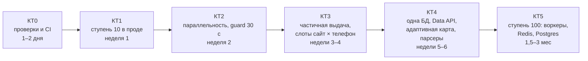

# 07. План развития: контрольные точки, проверяемые тестами

План ведёт avia-bot от текущего кода к 100 одновременным людям за 6 контрольных точек (КТ0–КТ5). Точка считается пройденной, когда выполнены два условия:
- зелёные `pytest` и проверка мощности `loadtest/gate.py` с порогами из этого документа;
- для точек, которые меняют прод, — неделя живых метрик в `/status`.

Пороги взяты из замеров аудита (профиль телефонов v2, seed 7, `03_capacity.md` и `06_changes.md`) с запасом ~15% на шум симулятора (±10% между одинаковым кодом).

## Сводка

| КТ | Срок | Что получаем | Автоматическая проверка | Главный порог | Кто подтверждает |
|---|---|---|---|---|---|
| 0 | 1–2 дня | Проверки мощности исполняются, CI на каждый PR | `pytest`, `gate --profile quick` в CI | Базовая линия воспроизводится ±15% | Чат |
| 1 | неделя 1 | Ветки фазы 6 в проде, флаги ступени 10 | `gate --profile stage10` | B, 100 чел./2 тел.: люди p50 ≤ 2 мин, подписки ≤ 1,7× | Владелец по `/status` за 7 дней |
| 2 | неделя 2 | Параллельность при прежнем интервале 30 с | `gate --profile parallel` | A, 50 чел./4 тел.: последний ≤ 20 мин | Владелец по `/status` за 7 дней |
| 3 | недели 3–4 | Первый ответ за минуты, слоты «сайт × телефон» | `gate --profile stage50a` | A, 50/4: первая частичная выдача p95 ≤ 3 мин | Чат + живой прогон |
| 4 | недели 5–6 | Состояние переживает рестарт, подписки через Data API, карта по здоровью | `gate --profile stage50` | B, 50/4: люди p95 ≤ 5 мин, подписки p95 ≤ 1,5× | Владелец по `/status` |
| 5 | 1,5–3 мес | Несколько процессов, 8–12 телефонов | `gate --profile stage100` + chaos-тесты в compose | A, 100/8: p95 ≤ 20 мин; рестарт без потерь | Владелец |

## Общие правила для каждой КТ

- **Одна работа — одна ветка** от актуальной базы (`main` после влития `scale-audit-all`, до этого — сама `scale-audit-all`). Имя ветки: `kt<N>-<тема>`.
- **Сначала тест, потом код.** Каждая новая функция приходит с тестом, который без неё падает. Новые модули покрыты на 80% и больше.
- **Поведение по умолчанию не меняется**, новое включается флагом в `.env`. Исключение — чистые багфиксы.
- **Отчёт по точке** — файл `docs/audit/kt<N>.md`:
  - команды проверки и их вывод (таблица `gate`);
  - что не проверено;
  - какие флаги включать.
- **Регрессия запрещена.** Профиль `quick` гоняется на каждый PR. Если что-то стало хуже порога предыдущей КТ, PR не вливается.
- **Живые сайты нагрузкой не проверяются.** Мощность меряется только в симуляторе; телефоны — не больше 40 запросов в час.

## КТ0. Проверки и CI (1–2 дня, поведение бота не меняется)

Нужна, чтобы каждая следующая точка проверялась одной командой, а не вручную по таблицам.

Работы:
1. `loadtest/gate.py`: запускает профиль из `loadtest/gates.yaml`, сравнивает JSON прогонов с порогами и завершается с кодом 1, если порог не пройден. Вывод — таблица «метрика / порог / факт / ok».
2. Профили:

   | Профиль | Что гоняет | Время |
   |---|---|---|
   | `quick` | A 10 чел./2 тел., A 50/4 | ~3–4 мин, для CI |
   | `full` | A 100/8, B 100/2, B 100/4 | ~45 мин параллельно, вручную или ночью |

3. В `run.py` добавить метрику `first_partial`: время до первого сообщения с частью сайтов. Пока частичной выдачи нет, она равна полной.
4. Исправить артефакт симулятора (DECISIONS #24): виртуальные сутки начинаются в местную полночь, и лимит в 40 поисков считается правильно. Пересчитать базовую линию.
5. GitHub Actions: Python 3.12, `pytest -q` без сети, `gate --profile quick`. Запуск на push и PR.

Проверка:

| Что | Команда | Порог |
|---|---|---|
| Тесты | `python -m pytest -q` | ≥ 538 passed, 0 failed |
| Базовая линия (без флагов) | `python -m loadtest.gate --profile quick` | A 50/4: последний ≤ 41 мин (замер 32–36) |
| Сценарий C | `python -m loadtest.run --scenario C --users 100 --phones 2` | отказов по лимиту ≥ 150 (ожидание ~200, было 44 из-за артефакта) |
| CI | PR в форке | зелёная проверка |

## КТ1. Ступень 10 в проде (неделя 1)

Работы:
1. Владелец вливает `scale-audit-all` в `main`, разворачивает (`deploy/avia-bot.service` или compose) и включает флаги ступени 10 из `06_changes.md`: `PHONE_MAP`, `RETRY_OTHER_PHONE`, `SEARCH_PRIORITY`, `QUEUE_NOTICE`, `HEALTH_ALERTS`.
2. Новый код:
   - бюджет поисков на бота в час;
   - лимит новых людей в сутки при `TG_OPEN=1` (`04_tech_debt.md` §9).
3. `sites.yaml`: yandex `wait_for '"cont":null'` (2 → 20 партнёров), `phone_wait_seconds` 15–20 с для быстрых сайтов. Проверить 3–6 запросами в бюджете 40/ч.
4. Ежедневный бэкап `state/`.

Проверка в тестах:

| Что | Команда | Порог (замер аудита) |
|---|---|---|
| Новые лимиты | `pytest tests/test_bot_budget.py` (новый) | бюджет исчерпан → вежливый отказ, лимит не списан |
| A, 10 чел./2 тел., флаги ступени 10 | `gate --profile stage10` | p95 ≤ 10 мин (без флагов 10,7) |
| A, 50/2 | то же | последний ≤ 35 мин (30,9) |
| B, 100/2 | то же | люди p50 ≤ 2 мин (1,6); подписки p50 ≤ 1,7× (1,5) |
| yandex с `wait_for` | `pytest tests/test_yandex_travel.py` + новый снимок | ≥ 15 партнёров в снимке |

Проверка в проде, `/status` за 7 дней:
- доля успешных сборов по каждому сайту ≥ 85%;
- 0 капч;
- 0 случаев «застрял в поиске» (поиск по логу);
- 0 ошибок 400/429 при отправке уведомлений;
- p95 ожидания людей ≤ 10 мин.

Живой прогон через шлюз (запускает владелец): один поиск от кнопки до выдачи ≤ 5 мин, `/status` отвечает.

## КТ2. Параллельность при guard 30 с (неделя 2)

Только флаги и железо, без нового кода. Нужно 4 телефона: на 2 параллельность почти ничего не даёт.

Работы:
1. `.env`: `SITES_PER_SEARCH=6`, `MAX_PARALLEL_SEARCHES` = числу телефонов, `GUARD_SITE_CONCURRENCY` = половине. `GUARD_MIN_INTERVAL` остаётся 30.
2. +2 телефона, если их ещё нет. Новые телефоны добавить в `PHONE_MAP` после 3–5 пробных запросов на каждый сайт.
3. Мониторинг телефонов: температура и батарея через `device_status` в `/status`.

Проверка в тестах:

| Что | Команда | Порог (замер) |
|---|---|---|
| A, 50/4 | `gate --profile parallel` | последний ≤ 20 мин (17,0) |
| A, 100/8 | то же | последний ≤ 30 мин (26,3) |
| B, 100/4 | то же | люди p50 ≤ 1 мин (0,6); подписки p95 ≤ 1,6× (1,4) |
| Частота запросов к сайту | `pytest tests/test_guard.py` | между стартами сбора одного сайта ≥ 30 с при любой `GUARD_SITE_CONCURRENCY` |

Проверка в проде за 7 дней: 0 капч, успешных сборов ≥ 85%, температура телефонов — записать (порог не измерен, зафиксировать базовую линию).

`GUARD_MIN_INTERVAL` ниже 30 с — отдельное решение после замера антибота: на тех же сайтах, 10–20 запросов в час с телефона, неделя без капч.

## КТ3. Ступень 50, часть 1: первый ответ за минуты (недели 3–4)

ADR-001. Сейчас человек видит выдачу, только когда соберутся все 6 сайтов.

Работы:
1. Частичная выдача: быстрые сайты отправляются сразу, остальные дописываются через `editMessageText`, не чаще 1 раза в секунду на чат.
2. Единица планирования — сбор сайта на телефоне: замок на пару «сайт × телефон», `min_interval` на сайт, глобальный семафор ≈ числу телефонов.
3. Оценка «примерно M мин» в очереди — по реальному времени сборов, а не по константе.

Проверка в тестах:

| Что | Команда | Порог |
|---|---|---|
| Частичная выдача | `pytest tests/test_partial_results.py` (новый) | первый кусок уходит после первого готового сайта; финальное сообщение = полная выдача; при сбое сайта — пометка, а не ошибка |
| Лимиты Telegram | то же, мок Telegram | 0 ответов 429 при 50 одновременных |
| Слоты «сайт × телефон» | `pytest tests/test_slots.py` (новый) | два разных сайта идут параллельно на разных телефонах; один сайт держит ≥ 30 с между стартами |
| A, 50/4 | `gate --profile stage50a` | первая частичная выдача p95 ≤ 3 мин; последний полный ≤ 20 мин |
| A, 100/8 | то же | первая частичная p95 ≤ 5 мин |
| Оценка ожидания | то же, `queue_eta_error` (новая метрика) | медианная ошибка «примерно M мин» ≤ 30% |

## КТ4. Ступень 50, часть 2: устойчивость и подписки (недели 5–6)

ADR-002, ADR-003, ADR-004 и парсеры.

Работы:
1. Одна SQLite в режиме WAL вместо трёх файлов, миграции, сессии и снимки выдачи в БД с TTL.
2. Предфильтр подписок через Travelpayouts Data API (`prices_for_dates`). Телефон собирает данные, только когда кэш показывает возможное изменение цены, плюс страховочный полный опрос раз в T часов. Нужен `TP_TOKEN` (даёт владелец).
3. Адаптивная карта «сайт × телефон»: скользящая доля успеха пары, пробные запросы, пара ниже порога выводится из карты.
4. Парсеры:
   - `ParseStats` для каждого сайта;
   - одна политика пропуска кривых элементов (onetwotrip сейчас падает целиком);
   - `ParserSpec` вместо поиска через `sys.modules`;
   - негативные снимки в тестах: пустая выдача, капча, изменённый формат.

Проверка в тестах:

| Что | Команда | Порог |
|---|---|---|
| Миграция | `pytest tests/test_migrations.py` (новый) | три старые БД из фикстур → одна, все записи на месте, повторный запуск ничего не ломает |
| Рестарт | `loadtest.run --scenario B --restart-at 12h` (новый флаг) | после рестарта 100% сессий и последних выдач на месте, 0 потерянных подписок |
| Предфильтр Data API | `pytest tests/test_prefilter.py` (новый) + мок Data API в симуляторе | сборов подписок на телефонах ≤ 50% от КТ2; изменение цены ≥ 5% замечено не позже 2 обещанных интервалов в ≥ 95% случаев |
| Адаптивная карта | `loadtest.run --fail-pair redmi:aviasales@6h` (новый флаг) | пара выведена не позже чем через 10 запросов; последний ждёт не дольше, чем со статической картой |
| Парсеры | `pytest tests/test_*_negative.py` (новые) | на каждом негативном снимке — понятная ошибка и счётчик в `ParseStats`, а не 0 вариантов молча |
| B, 50/4 | `gate --profile stage50` | люди p95 ≤ 5 мин; подписки p95 ≤ 1,5× |
| A, 50/4 | то же | p95 ≤ 20 мин; первая частичная ≤ 3 мин |

Проверка в проде: доля успешных сборов ≥ 90% по каждому сайту за неделю.

## КТ5. Ступень 100: несколько процессов (1,5–3 месяца)

Только после КТ4 и юридической оценки открытого режима (условия сайтов).

Работы:
1. Очередь вне процесса (Redis + arq), сборщики отдельными процессами.
2. Postgres вместо SQLite, Redis для кэша и замков.
3. Webhook, бот без состояния, 2 экземпляра.
4. Метрики Prometheus и алерты: очередь, ожидание, доля успеха по паре, температура телефонов.
5. 8–12 телефонов; прямые JSON-вызовы для 1–3 сайтов — только с согласия владельца и после проверки антибота.

Проверка в тестах:

| Что | Команда | Порог |
|---|---|---|
| Интеграция | `docker compose -f compose.test.yml up --exit-code-from tests` (новый) | все тесты зелёные с настоящими Redis и Postgres |
| Падение сборщика | chaos-тест: убить сборщик посреди поиска | поиск завершается на другом сборщике ≤ 2 мин, 0 потерянных |
| Падение бота | chaos-тест: убить 1 из 2 экземпляров | 0 потерянных сессий и уведомлений |
| A, 100/8 | `gate --profile stage100` | p95 ≤ 20 мин; первая частичная ≤ 3 мин |
| B, 100/8 | то же | люди p95 ≤ 5 мин; подписки p95 ≤ 1,5× |

## Решения владельца по ходу

| Когда | Решение |
|---|---|
| До КТ1 | Влить `scale-audit-all` в `main`; переписывать ли историю ради IP сервера |
| КТ1 | Включить флаги в проде; запустить шлюз для живого прогона |
| КТ2 | Купить и подключить ещё 2 телефона |
| КТ4 | Дать `TP_TOKEN` для Data API |
| КТ5 | Юридическая оценка, бюджет 15–35 тыс. ₽/мес, прямые JSON-вызовы |
